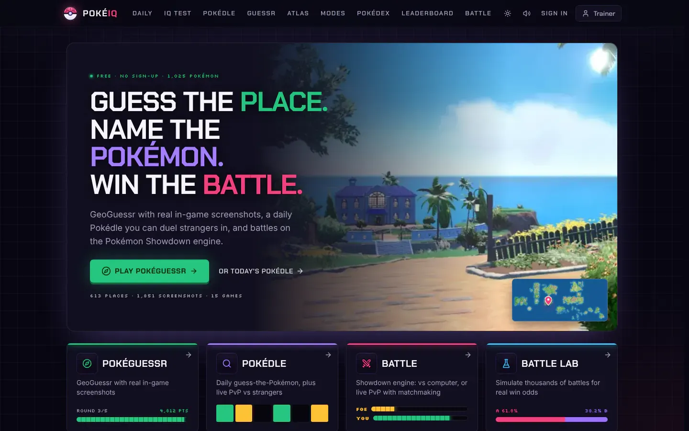
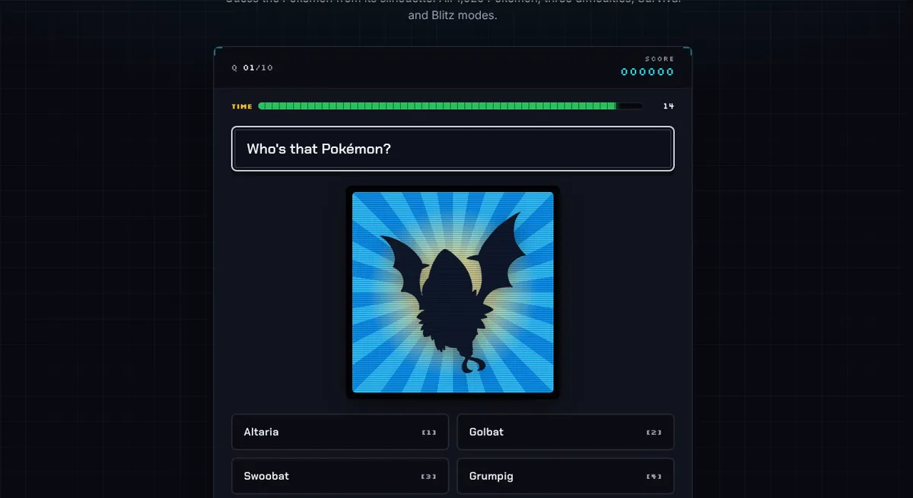
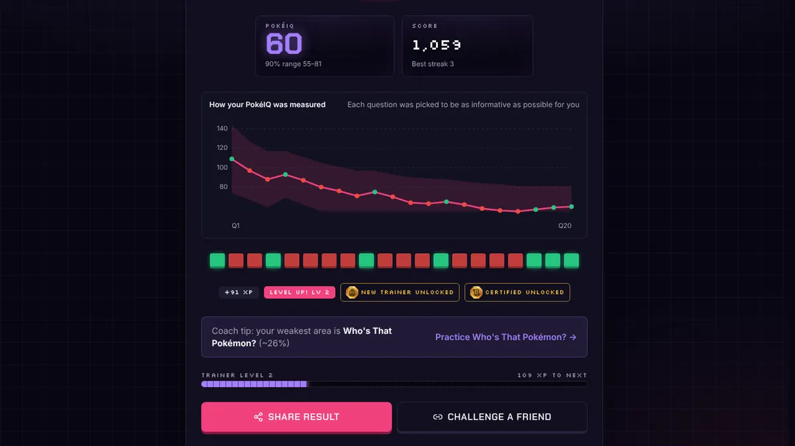
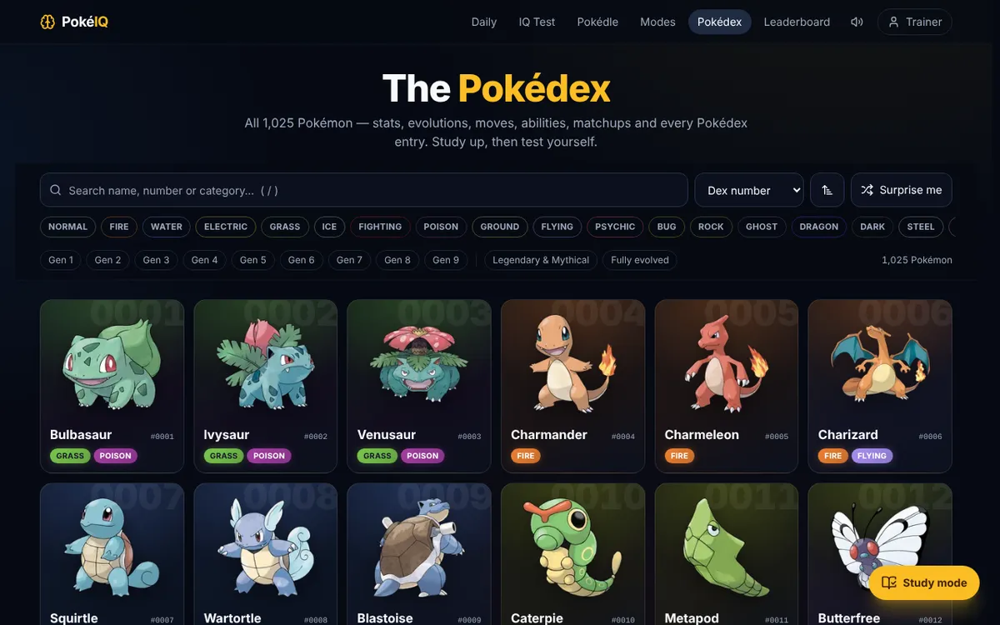
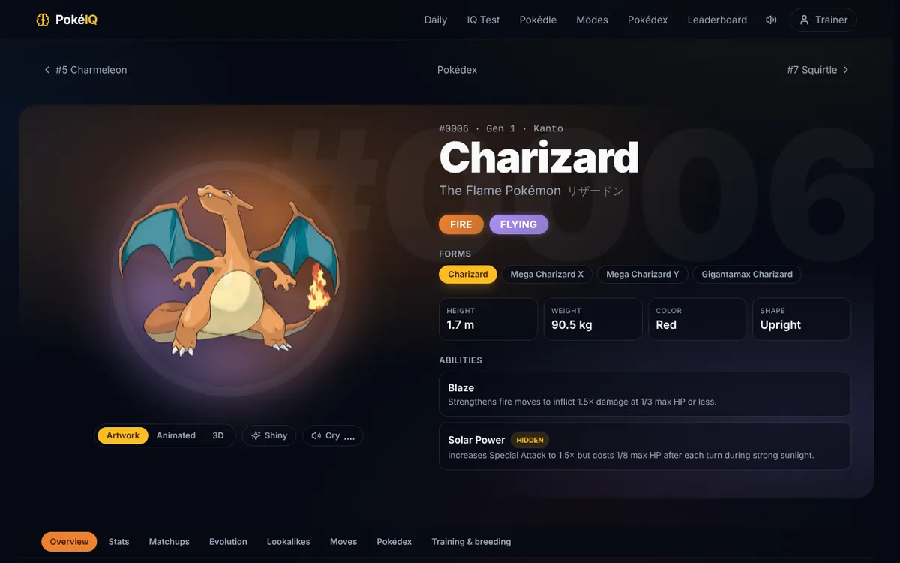
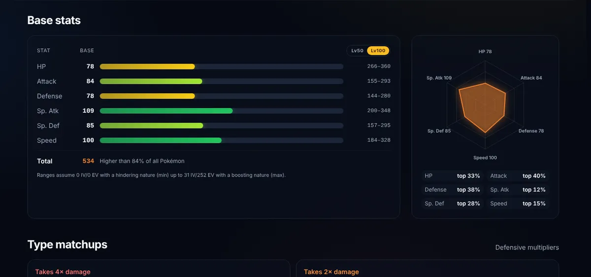
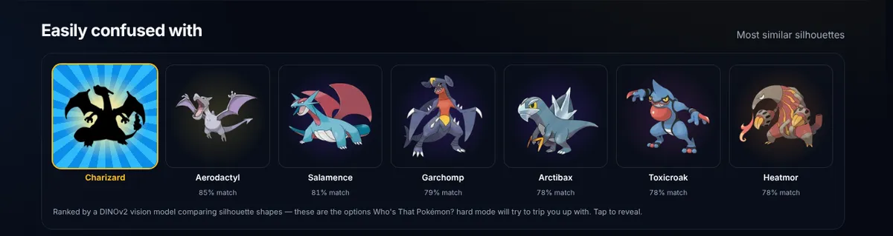
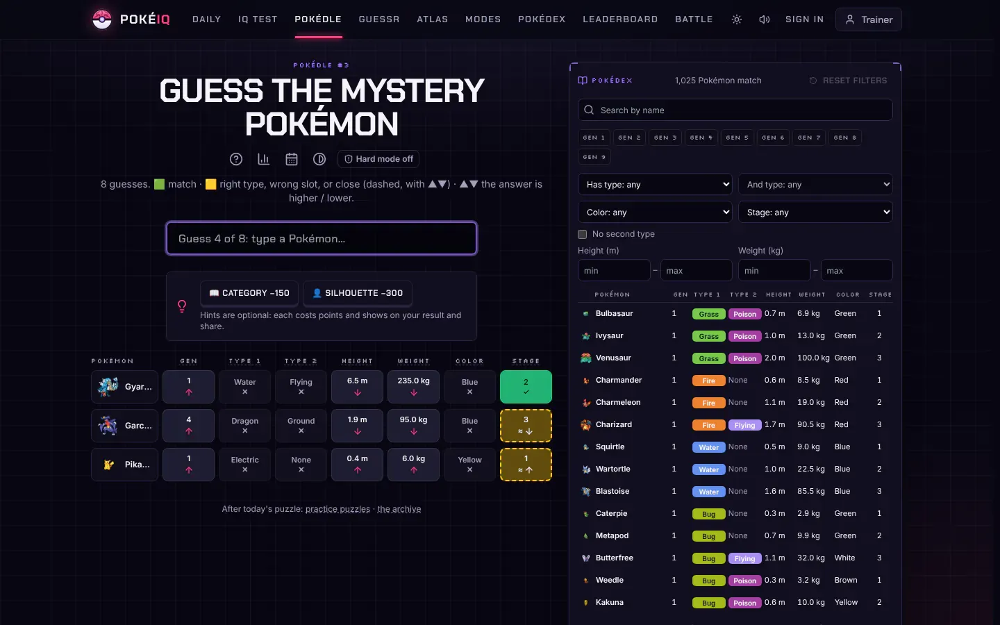
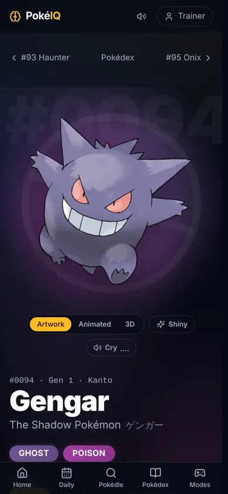
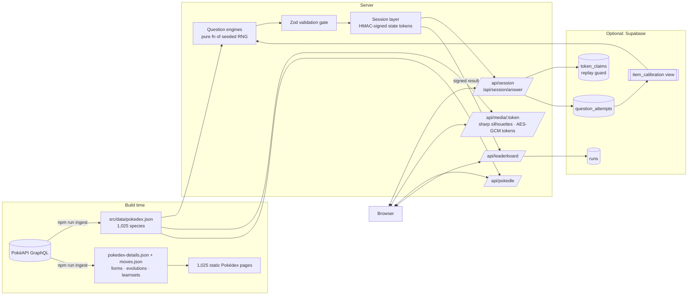

# PokéIQ

**The ultimate Pokémon knowledge test.** Daily challenges, a Pokédle, Who's That Pokémon silhouettes, cry quizzes, Pokédex entries, type matchups and stat battles, all scored with an adaptive rating that turns your answers into a **PokéIQ**.

Every question is generated on demand from a snapshot of all 1,025 Pokémon. No question is hand-written, answers are graded on the server, and every result doubles as a challenge link your friends can replay.

<p align="center">
  
</p>

<p align="center">
  
</p>

| Who's That Pokémon? | Adaptive PokéIQ Test |
|---|---|
|  |  |
| **Pokédex** | **Pokémon entry** |
|  |  |
| **Stats & radar** | **Silhouette lookalikes (DINOv2)** |
|  |  |
| **Pokédle** | **Mobile** |
|  |  |

## Features

| | |
|---|---|
| **PokéIQ Test** | A computerized adaptive test (the technique behind the GRE and GMAT): 20 questions, each picked for maximum Fisher information at your current estimate, scored as a PokéIQ with a 90% confidence range and a convergence chart |
| **Daily Challenge** | 10 mixed questions, identical for every player that day (date-seeded), with a spoiler-free 🟩🟥 share grid and a daily leaderboard |
| **Pokédle** | Daily Squirdle-style deduction: 8 guesses, with feedback on generation, types, height, weight, color and evolution stage. Unlocks hints (silhouette, then category). Unlimited practice mode |
| **Who's That Pokémon?** | Silhouettes rendered on the server, with a "zoomed-in" hard mode |
| **Cry Quiz** | Identify Pokémon by their in-game cry |
| **Dex Detective** | Censored Pokédex entries, categories ("the Seed Pokémon") and abilities |
| **Type Master** | Typings, damage multipliers, 4× weaknesses and immunities, computed from the 18×18 type matrix |
| **Higher or Lower** | Two Pokémon, one stat (Speed, BST, weight…) |
| **Formats** | Classic (10 × 15s), Survival (3 lives, endless) and Blitz (60s), with per-generation filters ("Gen 1 purist") |
| **Challenge links** | `/c/<token>` replays the exact same questions and shows a head-to-head result; dynamic Open Graph cards for Discord, X and iMessage |
| **Progression** | XP, levels, daily streaks, 14 badges and a trainer card, stored in the browser with no signup needed |
| **Pokédex** | Searchable explorer (type and generation filters, sort by any stat, infinite scroll) and a page for every species: animated / 3D / shiny art with tilt, cries, Mega / regional / Gigantamax forms, stat bars with radar chart, Lv 50/100 ranges and percentiles, full type matchups, branching evolution trees with methods, complete learnsets (level-up / TM / egg / tutor), every Pokédex entry by game, breeding, training, regional dex numbers and names in 7 languages |
| **Lookalikes** | A DINOv2 vision model embeds every silhouette offline. Its nearest neighbours drive hard-mode Who's That distractors and each Pokédex page's "easily confused with" panel |
| **Coach** | Per-generation, per-type and per-mode accuracy with empirical-Bayes smoothing. It surfaces your focus areas and strengths and links each one to the right study tool |
| **Study mode** | Flip-and-swipe flashcards (silhouette, Pokédex entry or typing) with missed cards re-queued and per-generation mastery tracking; quiz answers link straight to the Pokédex |
| **SEO** | 15 quiz landing pages plus 1,025 static Pokémon pages, with a sitemap, JSON-LD and canonical URLs |
| **Sound** | Synthesized Web Audio effects (no audio files) for answers, streaks and results, with a mute toggle (`M`) |
| **PWA** | Installable on iOS and Android, with safe-area insets and app shortcuts |

## Architecture



### Key design decisions

- **Own the data.** GraphQL requests at build time produce committed snapshots: a lean 1 MB quiz dataset, and a separate 3 MB study dataset (learnsets, forms, evolution methods) that only the statically generated Pokédex pages read, so the quiz runtime never loads it. Client components import only `lib/pokemon/constants.ts`, which keeps both datasets out of browser bundles. At runtime, generating a question is an in-memory function that takes microseconds, makes no third-party calls, and can't be rate-limited or taken down by PokéAPI.
- **Questions are a pure function of `(seed, options)`.** The server never stores a question. It re-derives question *N* of a session whenever it grades one, which makes Daily Challenges and challenge links free: same seed, same quiz.
- **Seeds are HMAC'd.** The generator is open source and the public seed is visible in tokens, but the RNG is seeded with `HMAC(secret, seed)`. Without the server secret, nobody can precompute a quiz's answers from this repo.
- **Server-authoritative scoring.**
  - The browser never receives an answer before committing to a choice.
  - Session state lives in HMAC-signed tokens, and timing comes from server clocks.
  - Each `(session, question)` can be graded only once. A replay guard backed by a Postgres unique key stops replaying an old token after seeing the solution.
  - The leaderboard accepts only a server-signed result token. There's no score field to forge, and the anon key is read-only under RLS.
- **No answer leaks through media.** Silhouette and cry URLs are AES-GCM encrypted tokens, so there's no Pokédex number in the URL. Silhouettes are rendered with `sharp` on the server, so the full-colour art reaches the browser only after grading.
- **Self-verifying output.** Every generated question passes a Zod gate (answer in the options, no duplicates). Builders refuse ambiguous questions such as stat ties or shared categories instead of shipping them.

### The PokéIQ rating

Players and questions share one Elo-style scale. The probability of a correct answer follows an item-response-theory curve with a guessing floor (3PL with `c = 1/options`):

```
P(correct) = g + (1 − g) / (1 + 10^((item − player) / 400))
```

A run's PokéIQ is the MAP estimate of the player's rating given the items answered: bisection on the likelihood gradient with a Gaussian prior. It's then mapped to an IQ-style scale (mean 100, SD 15). Ten easy questions right is worth less than ten hard ones.

Items start with heuristic priors (generation, zoom, distractor similarity, stat gap). Once Supabase is connected, every graded answer is logged and the `item_calibration` view inverts the same curve to compute an empirical difficulty per item. The server swaps it in after 30 attempts, so difficulty sharpens as the player base grows.

### Machine learning and psychometrics

| Component | Technique | Where |
|---|---|---|
| Ability estimation | 3PL item response model, Bayesian MAP estimate with Gaussian prior, standard error from Fisher information | `src/lib/rating.ts` |
| Adaptive testing | Max-information item selection with top-3 randomisation, deterministic replay from the signed answer log, memoised per answer prefix | `src/lib/server/session.ts` |
| Item calibration | Logged attempts feed a Postgres view that inverts the response curve for an empirical difficulty per item | `supabase/migrations`, `src/lib/server/calibration.ts` |
| Silhouette similarity | DINOv2-small embeddings (Transformers.js / ONNX, offline) of each silhouette plus its mirror, then exact cosine kNN | `scripts/silhouette-lookalikes.ts` |
| Weak-spot coach | Beta-prior (empirical-Bayes) smoothing of per-skill accuracy | `src/lib/coach.ts` |

**Simulation results.** 175 simulated players span true ratings 700–1900, and their answers are drawn from the same response model. After 20 questions the adaptive test's estimate is off by **88 rating points on average (≈ 6.6 IQ points)**. A fixed 20-question quiz is off by **123 points (≈ 9.2 IQ points)**, so adaptive selection cuts the error by about 28%, with the biggest gains for very strong and very weak players. These numbers assume the item difficulties are correct; real-world accuracy depends on calibration data. Tests in `tests/adaptive.test.ts` check that the adaptive test serves harder questions to stronger players and ranks them above weaker ones.

## Getting started

```bash
npm install
npm run dev            # http://localhost:3000
```

It works with zero configuration. For production:

| Variable | Required | Purpose |
|---|---|---|
| `POKEIQ_SECRET` | **yes** | Signs tokens and derives seeds. Use any long random string (`openssl rand -base64 32`) |
| `SUPABASE_URL` | no | Enables trainer accounts, leaderboards, cross-instance replay protection and difficulty calibration |
| `SUPABASE_SERVICE_ROLE_KEY` | no | Server-only. Never prefix it with `NEXT_PUBLIC_` |
| `NEXT_PUBLIC_SITE_URL` | no | Canonical URL for the sitemap and OG tags (defaults to the Vercel production URL) |

To set up Supabase, create a free project and run the files in `supabase/migrations/` (in order) in its SQL editor.

### Trainer accounts

Progress is local-first, so anyone can play without signing up. Creating an account (trainer name + password, no email) syncs XP, badges, streaks and PokéIQ across devices:

- Passwords are hashed with scrypt and a per-user salt and compared in constant time; unknown names take the same time to reject.
- Sessions are 256-bit random tokens in an HTTP-only, SameSite cookie, and only their SHA-256 is stored.
- A one-time recovery code replaces email resets; using it rotates the code and signs out every other device.
- Auth routes are rate-limited and reject cross-site requests. Account tables are RLS-locked to the service role.

Accounts need Supabase in production. Locally they use a JSON file in `.data/` (set `POKEIQ_LOCAL_ACCOUNTS=1` to use it with `npm start`).

**To deploy:** import the repo into Vercel, set the variables above, and deploy. Vercel Analytics is already wired in, with custom events for quiz start and complete, shares, challenges and Pokédle.

## Testing

```bash
npm run lint           # ESLint (next/core-web-vitals + TypeScript rules)
npm run typecheck      # strict TypeScript
npm test               # Vitest: RNG, type matrix, all engines × difficulties × 60 seeds,
                       # signed/encrypted tokens, session grading, Survival, Pokédle, rating
npm run build
npm start & npm run verify:e2e   # Playwright: full run → challenge link → OG image,
                                 # every mode, Blitz, Pokédle, accounts, mobile viewport
```

CI (`.github/workflows/ci.yml`) runs all of these on every push and PR, and uploads E2E screenshots as artifacts.

Refresh the data when a new generation ships:

```bash
npm run ingest         # Pokédex + study data (~10 s)
npm run lookalikes     # DINOv2 silhouette index (~3 min on CPU; dev-only dependency)
npm run icons          # regenerate favicon / PWA icons from src/lib/brand/logo-svg.ts
```

## Project layout

```
src/
├── data/                         # committed snapshots (npm run ingest)
│   ├── pokedex.json              #   quiz data
│   └── pokedex-details.json, moves.json  # study Pokédex data
├── engines/                      # question builders (pure, seeded) + Zod gate
│   └── modules/                  # whos-that · cry · dex · types · higher-lower
├── lib/
│   ├── server/                   # session, crypto, replay guard, rate limit,
│   │                             # calibration, pokedle, leaderboard, auth + accounts
│   ├── rating.ts                 # IRT/Elo PokéIQ model
│   ├── progress.ts               # local XP / streaks / badges store
│   └── pokemon/                  # Pokédex access + 18×18 type matrix
├── app/
│   ├── api/                      # session · answer · media · pokedle · leaderboard · auth · progress
│   ├── daily · pokedle · play · trainer · leaderboard
│   ├── quiz/[slug]               # 15 SEO landing pages, one route
│   ├── pokedex · pokedex/study   # explorer + flashcards
│   ├── pokemon/[slug]            # 1,025 static Pokédex pages
│   ├── api/art/[id]              # CDN-cached WebP artwork thumbnails
│   └── c/[token]                 # challenge links + dynamic OG image
└── components/                   # QuizController (one runtime for every mode)
scripts/ingest-pokedex.ts · ingest-details.ts · silhouette-lookalikes.ts · e2e-smoke.mjs
supabase/migrations/          # 0001 schema · 0002 adaptive test · 0003 hardening · 0004 accounts
tests/
```

## Roadmap

- Optional Discord or Google sign-in alongside trainer-name accounts
- Localized Pokémon names (already in the snapshot: es, fr, de, it, ja, ko)
- Name-All Blitz (typed recall) and a PokéGrid daily puzzle
- Discord bot with `/daily`
- Sentry error monitoring

## License

Source code is released under the [MIT License](LICENSE). Pokémon assets and names belong to their respective owners.

---

PokéIQ is a free, non-commercial fan project. It is not affiliated with, endorsed or sponsored by Nintendo, Game Freak, Creatures or The Pokémon Company. Pokémon data comes from [PokéAPI](https://pokeapi.co).
