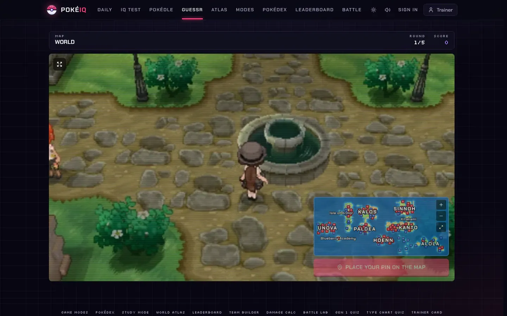
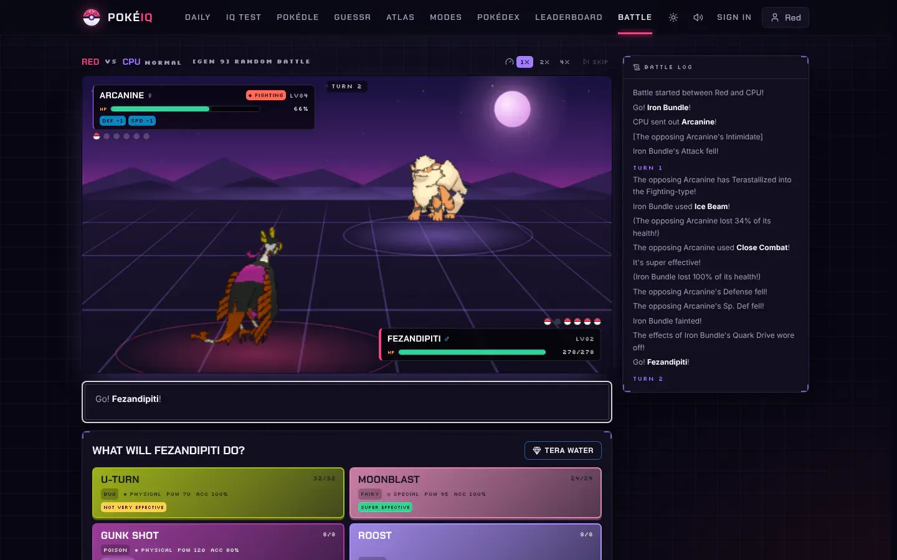
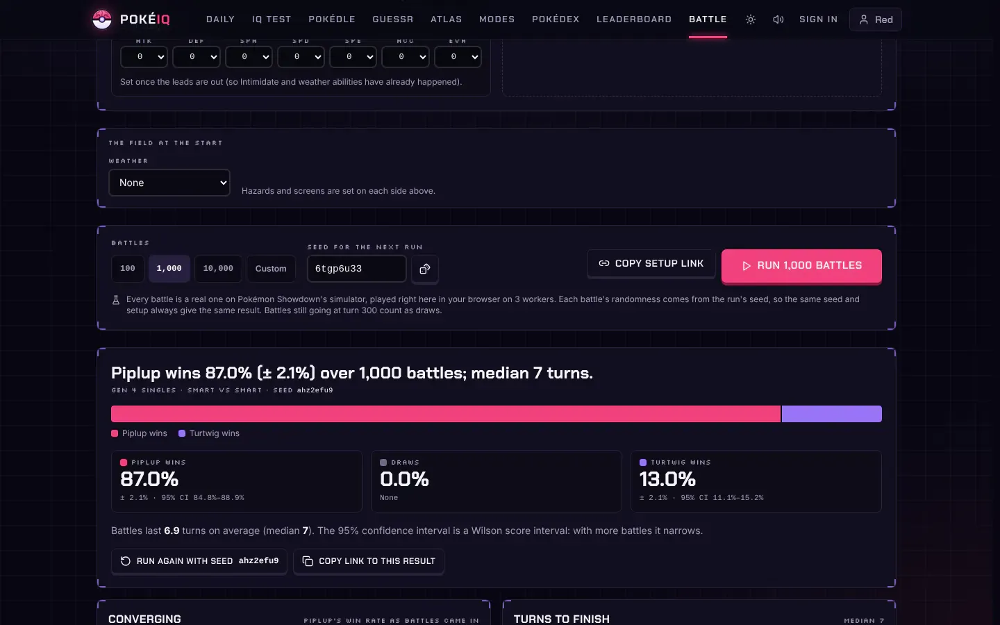
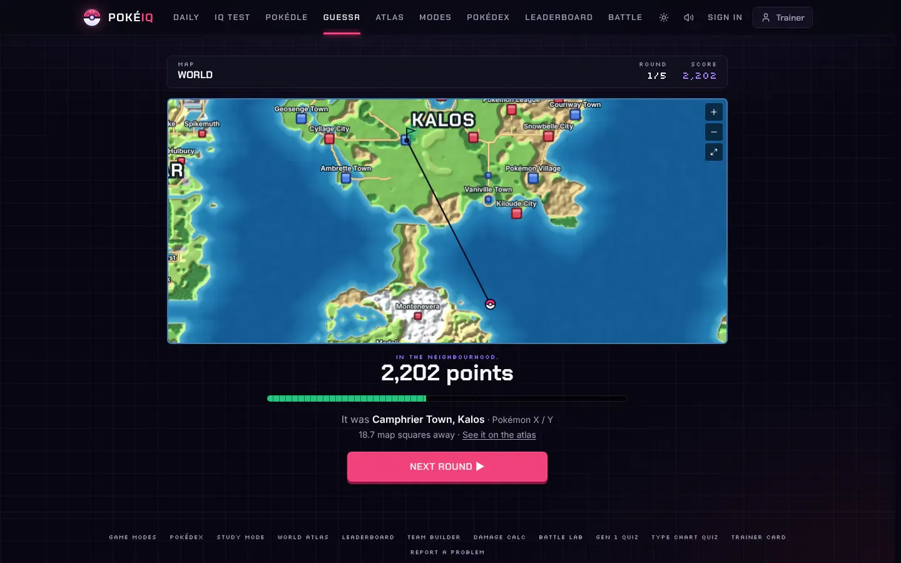
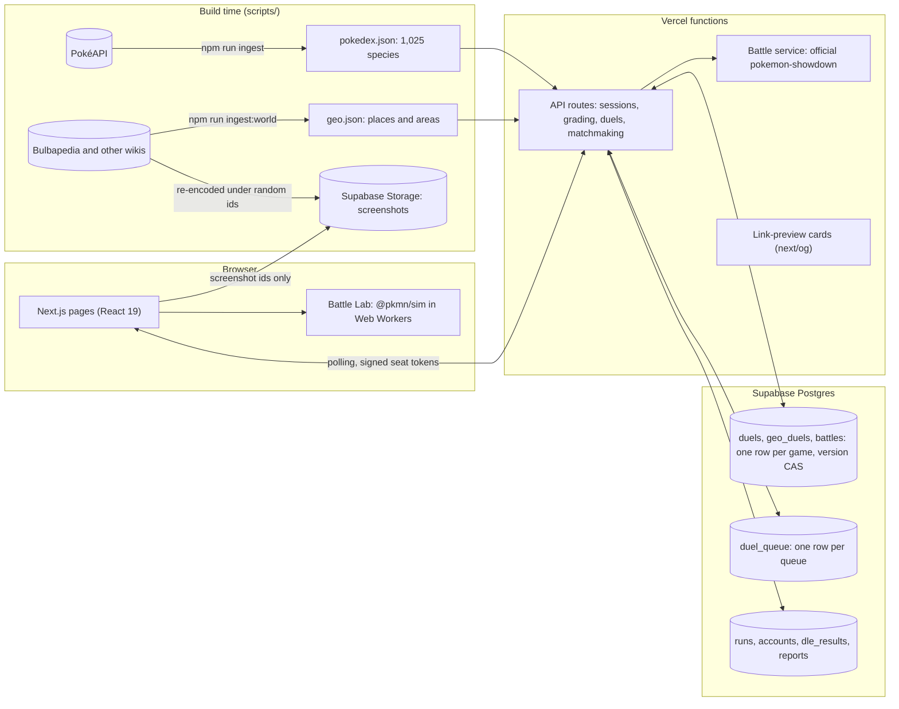

# PokéIQ

**GeoGuessr, Wordle and Pokémon Showdown in one free Pokémon site.** Guess where an in-game screenshot was taken, solve the daily Pokédle or duel a stranger at it, battle on the official Showdown engine, and simulate thousands of battles to see who really wins.

**Play it: [pokeiq.vercel.app](https://pokeiq.vercel.app)**. No sign-up, works on desktop and mobile.

<p align="center">
  
</p>

## What you can play

| | |
|---|---|
| **PokéGuessr.** GeoGuessr for the Pokémon world: 1,573 real in-game screenshots of 600+ places from 15 games, Kanto to Paldea. Drop a pin on the world map and score up to 5,000 a round. Daily game, streak mode, challenge links and live 1v1 duels with HP, against a friend or a stranger. |  |
| **Pokédle.** A daily guess-the-Pokémon with clues for generation, types, height, weight, colour and evolution stage, a filterable Pokédex beside the board, community stats once you finish, and three-round live duels against a friend or a stranger. |  |
| **Battles.** Real battles on the official Pokémon Showdown simulator: Random Battle, Random Doubles, OU, Ubers, UU and Doubles OU, against a computer opponent (three levels) or live against another player found by matchmaking or an invite link. Team builder with Showdown's own legality check, and the Smogon damage calculator. |  |
| **Battle Lab.** Set up any two teams, Gen 1 to 9, and run the battle up to 50,000 times in your browser. Win rates with 95% confidence intervals, battle length, who scores the KOs, and replays of sample battles. |  |

Also: adaptive quizzes on all 1,025 Pokémon (silhouettes, cries, Pokédex entries, type matchups, higher-or-lower) scored by an item-response rating, a daily challenge, a full Pokédex with a page per species, flashcards, a zoomable world atlas, leaderboards and optional trainer accounts.

<p align="center">
  
  
  
</p>

## Engineering highlights

**Server-authoritative live duels without a game server.** PokéGuessr, Pokédle and quiz duels and live battles all run on Vercel functions and one Postgres row per game. Nothing runs on a timer: every poll or action catches the duel up on the steps that are due (a round closing, the next one starting, a silent player forfeiting), each dated by the rules rather than by when the request arrived, so both players always see the same game. Every write is a compare-and-swap on the row's version, so two players acting in the same millisecond can't overwrite each other, and each player holds an HMAC-signed seat token, so nobody can act for anyone else. Views are cut per player: an answer and the opponent's pin leave the server only in the reveal. (`src/lib/server/duel-core.ts`, `duel-store.ts`)

**Matchmaking with strangers from a single-row queue.** Each queue (`geo:world`, `pokedle:all`, `battle:gen9ou` …) is one row holding at most one waiting player. A search either pairs with a waiting player who is still polling, opening the game with both seated, or becomes the one waiting. Every change to the row is a compare-and-swap, so two searches can never wait on each other and a waiting player is never paired twice; a search not heard from in 8 seconds is passed over. Battle formats that need your own team check it against the format's rules before you join the queue. (`src/lib/server/match-queue.ts`)

**Stateless games with sealed round plans.** A PokéGuessr game is a token, not a database row: its five rounds are planned up front, then encrypted (AES-256-GCM) into the signed token, so the server can grade any guess without storing anything and the player can't read the places out of it. Screenshot URLs carry random ids, and the id-to-place mapping never leaves the server. Quiz questions are a pure function of an HMAC'd seed, and silhouettes and cries are served behind encrypted media tokens, so the open-source code can't be used to precompute answers. (`src/lib/server/geo.ts`, `crypto.ts`, `session.ts`)

**Fair sampling with recency steering.** Rounds are drawn by area, not by screenshot: a town and every building in it count as one draw, so a place with 20 screenshots isn't 20 times as likely as a route with one, and a world game takes each round from a different region. For free play the server tries 64 seeds and keeps the one whose rounds overlap least with the player's recent places, weighted toward the latest. (`planRounds`, `staleness` in `src/lib/server/geo.ts`)

**A screenshot pipeline that keeps pixel art crisp.** `scripts/ingest-world.ts` collects views from Bulbapedia, the Bulbagarden Archives and three other Pokémon wikis, keeps only screen-shaped captures, drops near-copies by image hash, and denylists shots that name the place or show the wrong one after a review of every contact sheet. Sprite-game shots are detected at their true pixel scale, reduced to native resolution with nearest-neighbour, then scaled back up by a whole number and saved as lossless WebP, so they stay sharp at any size; 3D captures are capped at 1,600 px. (`scripts/geo/bulbapedia.ts`)

**Battles on the official Showdown engine, with a parity harness.** Live and computer battles run the `pokemon-showdown` package on the server; the Battle Lab runs `@pkmn/sim`, Showdown's simulator packaged for the browser. `npm run verify:showdown` (`scripts/showdown-parity.ts`) plays 2,000 battles across 12 scenarios (random battles for every generation, Random Doubles, a fixed Gen 4 matchup and Gen 9 OU) on both engines with the same seeds, teams and choices, and compares every request and the full omniscient log line by line, plus both team validators on edge-of-legality sets. Every difference is classified rather than just counted: on the latest run (1.29 million log lines in about three minutes), the fixed-team scenarios matched line for line in all 332 battles, and every divergence in the random formats traced to a known cause, either newer random-battle set lists and format text in the official package or one of a short, named list of mechanics fixes (Gen 3-4 Encore timing, Gen 4 Truant, Pursuit on a switch, recoil message details). That tells you exactly where the Lab can differ from the live game, and why.

**The jsonb key-order bug.** In live battles, one player's move kept voiding the other's: their choice came back "out of date" and their turn clock restarted. Postgres `jsonb` hands objects back with their keys reordered, so the stored copy of a player's pending request never string-matched the simulator's fresh one, and every write looked like a new request. The fix compares by content through a canonical (key-sorted) JSON, and the in-memory test store now reorders keys the way `jsonb` does, so the tests see what production sees. As a bonus, duels stopped writing to the database on polls where nothing changed. (`src/lib/server/canonical-json.ts`)

**Battle Lab: Monte Carlo in Web Workers.** Battles are split across a pool of Web Workers sized to the device's cores, each playing seeded battles with scripted decision policies. Every battle's randomness comes from the run's seed, so a result link replays exactly. Win rates are reported with Wilson score intervals, which stay honest near 0% and 100% where the normal approximation breaks down. (`src/lib/battle/lab/`)

**Pokédle's daily scheduler.** The answer for each date is dealt from a curated pool like a deck: a keyed shuffle (HMAC with the server secret, so the public code can't predict it) where no Pokémon repeats until the whole pool has been used, about 800 days. Within a cycle, the weekday sets the difficulty tier, generations are spread evenly, consecutive days avoid the same generation and primary type, and an evolution family sits out for several days after one of it was the answer. Past days keep their answers for good, so the archive replays them. Community stats (solve rate, guess distribution, most popular openers) are served from a 30-second CDN cache and shown only after you finish. (`src/lib/server/pokedle-schedule.ts`, `src/app/api/pokedle/stats`)

**Moderation and abuse limits.** A name filter folds accents, look-alike letters from other scripts, leetspeak and repeated letters before matching, while letting every Pokémon name and words like "Scunthorpe" through; it runs in forms and again on the server for every name another player can see. Grading, duel, matchmaking, leaderboard and auth endpoints are behind token-bucket rate limits, leaderboards accept only server-signed result tokens, and a "report a problem" form and the browser error reporter write to a `reports` table. (`src/lib/name-filter.ts`, `src/lib/server/rate-limit.ts`)

**Tested end to end.** 344 Vitest tests across 33 files cover the RNG, every quiz engine at every difficulty, tokens and grading, duels and matchmaking under concurrent writes, the battle service and the Pokédle schedule. A Playwright smoke test (`scripts/e2e-smoke.mjs`) plays every mode in a real browser, including two-browser PokéGuessr, Pokédle and quiz duels and a live battle, checks that no hidden battle data reaches the other player, and fails on any console error. CI runs lint, type check, tests, build and the smoke test on every push.

## Architecture



## Tech stack

- **App:** Next.js 15 (App Router, React Server Components), React 19, TypeScript (strict), Tailwind CSS
- **Data:** Supabase (Postgres with row-level security, Storage), with an in-memory fallback so the game runs with no configuration
- **Battles:** `pokemon-showdown` (server), `@pkmn/sim`, `@pkmn/client` and `@pkmn/view` (browser), `@smogon/calc`
- **Images:** `sharp` for silhouettes and screenshot encoding, `next/og` for share cards
- **Validation and testing:** Zod on API inputs, Vitest, Playwright, GitHub Actions
- **Hosting:** Vercel, with Vercel Analytics

## Running it locally

```bash
npm install
npm run dev            # http://localhost:3000
```

It works with no configuration: duels fall back to memory and accounts to a local file, and leaderboards switch off. For production, set:

| Variable | Purpose |
|---|---|
| `POKEIQ_SECRET` | Required in production. Signs tokens and seeds the RNG |
| `SUPABASE_URL` | Enables accounts, leaderboards, duels across instances and calibration |
| `NEXT_PUBLIC_SUPABASE_URL` | Fallback for `SUPABASE_URL` when locating the screenshot store |
| `SUPABASE_SERVICE_ROLE_KEY` | Server-only Supabase key |
| `NEXT_PUBLIC_SITE_URL` | Canonical URL for link previews and the sitemap (defaults to `https://pokeiq.vercel.app`) |
| `NEXT_PUBLIC_OAUTH_PROVIDERS` | "Continue with" buttons to show: `discord,google` (default), one of them, or empty to hide. Needs Supabase Auth with those providers on and `<site>/api/auth/oauth/callback` in its redirect URLs |
| `POKEIQ_LOCAL_ACCOUNTS` | `1` to use the local account file and in-memory duels with `npm start` |
| `POKEIQ_ADMINS` | Comma-separated trainer names who can open `/admin` (moderation). Empty by default: nobody |
| `NEXT_PUBLIC_SUPABASE_ANON_KEY` | Optional. With `NEXT_PUBLIC_SUPABASE_URL`, chat rooms get new messages live over Supabase Realtime instead of polling every 5 s |

To set up Supabase, run `supabase/setup.sql` in a new project's SQL editor.

## Tests

```bash
npm run lint                     # ESLint
npm run typecheck                # tsc --noEmit
npm test                         # Vitest: 344 tests
npm run build && npm start &
npm run verify:e2e               # Playwright smoke test of every mode
npm run verify:showdown          # 2,000-battle parity check against official Showdown
```

## Credits and licences

- In-game screenshots and place data: [Bulbapedia](https://bulbapedia.bulbagarden.net) and the Bulbagarden Archives, the Pokémon Wiki (Fandom), Poképédia and PokéWiki. Screenshots are the property of their copyright holders.
- Pokémon data, artwork and sprites: [PokéAPI](https://pokeapi.co).
- Battle simulation: [Pokémon Showdown](https://github.com/smogon/pokemon-showdown) (MIT) and the [@pkmn](https://github.com/pkmn) packages (MIT).
- Damage calculator: [@smogon/calc](https://github.com/smogon/damage-calc) (MIT).
- Battle music (original chiptune, never game music; details in [public/audio/battle/CREDITS.md](public/audio/battle/CREDITS.md)): "8-Bit RPG Battle/Encounter Theme" by Ted Kerr (Wolfgang_, CC0), "Battle! vs Minor Gyokaijuu" by Julie Damsgaard (Spring Spring, CC0), "Face The Champion!" by Julie Damsgaard (Spring Spring, [CC BY 3.0](https://creativecommons.org/licenses/by/3.0/), shortened) and "Glorious victory fanfare NES" by congusbongus (CC0), all from [OpenGameArt.org](https://opengameart.org).

PokéIQ's own source code is released under the [MIT License](LICENSE).

---

PokéIQ is a free, non-commercial fan project and is not affiliated with, endorsed or sponsored by Nintendo, Game Freak, Creatures or The Pokémon Company. Pokémon and all related names are trademarks of their respective owners. Data from PokéAPI.
