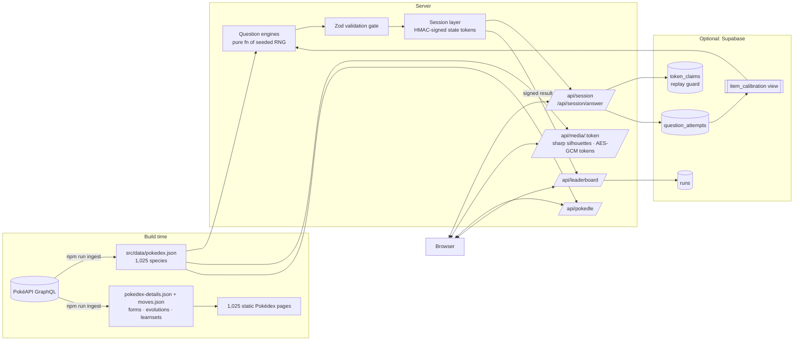

# PokéIQ

**The ultimate Pokémon knowledge test.** Daily challenges, a Pokédle, Who's That Pokémon silhouettes, cry quizzes, Pokédex entries, type matchups and stat battles, all scored with an adaptive rating that turns your answers into a **PokéIQ**.

Every question is generated on demand from a snapshot of all 1,025 Pokémon. No question is hand-written, answers are graded on the server, and every result doubles as a challenge link your friends can replay.

<p align="center">
  
</p>

<p align="center">
  
</p>

| Who's That Pokémon? | Adaptive PokéIQ Test |
|---|---|
|  |  |
| **Pokédex** | **Pokémon entry** |
|  |  |
| **Stats & radar** | **Silhouette lookalikes (DINOv2)** |
|  |  |
| **Pokédle** | **Mobile** |
|  |  |

## Features

| | |
|---|---|
| **PokéIQ Test** | A computerized adaptive test (the technique behind the GRE and GMAT): 20 questions, each picked for maximum Fisher information at your current estimate, scored as a PokéIQ with a 90% confidence range and a convergence chart |
| **Daily Challenge** | 10 mixed questions, identical for every player that day (date-seeded), with a spoiler-free 🟩🟥 share grid and a daily leaderboard |
| **Pokédle** | Daily Squirdle-style deduction: 8 guesses, with feedback on generation, types, height, weight, color and evolution stage. Unlocks hints (silhouette, then category). Beside the board, a reference Pokédex of every guessable Pokémon to work it out by elimination: filter by generation, type, colour, stage, height and weight, sort any column, click a row to fill in the guess (the filters are yours to set; it never reads your clues). Unlimited practice mode |
| **PokéGuessr** | GeoGuessr for Pokémon: dropped somewhere in the Pokémon world, you get an in-game view and drop a pin on the world atlas (the whole world, or one region's part of it), scoring up to 5,000 points a round on GeoGuessr's curve. Every place shows up in every game it's in, from Red / Blue to the latest remakes, picked fairly across the world and steered away from places you've just seen. Daily game, streaks, challenge links and leaderboards per map |
| **World atlas** | Every mainline region on one zoomable map, laid out like the real places they're based on, with every town, route and landmark labelled from the games' own maps |
| **PokéGuessr Duels** | Head-to-head PvP, GeoGuessr Duels style: pick a map, send a friend the link, both press Ready and you get the same places. Once one of you guesses, the other has 15 seconds. 6,000 HP each: every round the lower score loses the difference, times a multiplier that climbs from ×1.5 (round 4) to ×3. First to 0 HP loses, more HP wins after 10 rounds, leaving forfeits, and a rematch is one click |
| **Pokédle Duels** | Head-to-head Pokédle through a share link: three rounds, the same mystery Pokémon for both of you (never the day's solo answer, from all generations or the ones the creator picks). A solve scores 1,000 on the first guess down to 300 on the last, plus up to 150 for speed; hints are opt-in and cost points (category −150, silhouette −300). You see your opponent's colours and hint badges as they play, never their Pokémon. The most points wins, then fewer guesses, then less time |
| **Matchmaking** | "Find an opponent" on the PokéGuessr and Pokédle duel cards pairs you with anyone searching for the same game and map (Pokédle matches play every generation), no link needed. The duel starts on its own after a short countdown |
| **Quiz Duels** | Any quiz mode and difficulty, head to head through a share link: the same 10 questions for both of you (built on the server from one seed), 15 seconds each. You see when your opponent locks in, never what they picked; the reveal shows the right answer and both picks. A points race: 100 for a right answer plus up to 50 for speed, the most points after 10 questions wins. Start one from any quiz's setup screen or the game modes page |
| **Who's That Pokémon?** | Silhouettes rendered on the server, with a "zoomed-in" hard mode that always frames recognisable outline |
| **Cry Quiz** | Identify Pokémon by their in-game cry |
| **Dex Detective** | Censored Pokédex entries, categories ("the Seed Pokémon") and abilities |
| **Type Master** | Typings, damage multipliers, 4× weaknesses and immunities, computed from the 18×18 type matrix |
| **Higher or Lower** | Two Pokémon, one stat (Speed, BST, weight…) |
| **Formats** | Classic (10 × 15s), Survival (3 lives, endless) and Blitz (60s), with per-generation filters ("Gen 1 purist") |
| **Challenge links** | `/c/<token>` replays the exact same questions and shows a head-to-head result; dynamic Open Graph cards for Discord, X and iMessage |
| **Progression** | XP, levels, daily streaks, 19 badges and a trainer card. Local-first with no signup needed; optional accounts sync it across devices |
| **Pokédex** | Searchable explorer (type and generation filters, sort by any stat, infinite scroll) and a page for every species: animated / 3D / shiny art with tilt, cries, Mega / regional / Gigantamax forms, stat bars with radar chart, Lv 50/100 ranges and percentiles, full type matchups, branching evolution trees with methods, complete learnsets (level-up / TM / egg / tutor), every Pokédex entry by game, breeding, training, regional dex numbers and names in 7 languages |
| **Lookalikes** | A DINOv2 vision model embeds every silhouette offline. Its nearest neighbours drive hard-mode Who's That distractors and each Pokédex page's "easily confused with" panel |
| **Coach** | Per-generation, per-type and per-mode accuracy with empirical-Bayes smoothing. It surfaces your focus areas and strengths and links each one to the right study tool |
| **Study mode** | Flip-and-swipe flashcards (silhouette, Pokédex entry or typing) with missed cards re-queued and per-generation mastery tracking; quiz answers link straight to the Pokédex |
| **Team Builder** | Competitive teams for Gen 9 OU, Ubers, UU, Doubles OU, VGC 2025 Reg I, National Dex, Gen 4 OU and Gen 3 OU. Six slots with species search, moves limited to each format's learnsets (type, category, power, accuracy, PP), abilities, items, natures, Tera types, EV sliders, IVs and live stats. Every edit is checked by Pokémon Showdown's own team validator, with problems shown on the slot they belong to. Showdown import / export round-trips exactly; random legal teams; saved on the device |
| **Damage Calculator** | The Smogon damage calculator for Gens 3–9, both ways: every move's damage range in % and HP, KO chance and the full Showdown description. Boosts, status, Tera, current HP, weather, terrain, screens, hazards, doubles spread, crits, Helping Hand and the rest; load either side from a saved team |
| **SEO** | 15 quiz landing pages plus 1,025 static Pokémon pages, with a sitemap, JSON-LD and canonical URLs |
| **Sound** | Synthesized Web Audio effects (no audio files) for answers, streaks and results, with a mute toggle (`M`) |
| **PWA** | Installable on iOS and Android, with safe-area insets and app shortcuts |

## Architecture



### Key design decisions

- **Own the data.** GraphQL requests at build time produce committed snapshots: a lean 1 MB quiz dataset, and a separate 3 MB study dataset (learnsets, forms, evolution methods) that only the statically generated Pokédex pages read, so the quiz runtime never loads it. Client components import only `lib/pokemon/constants.ts`, which keeps both datasets out of browser bundles. At runtime, generating a question is an in-memory function that takes microseconds, makes no third-party calls, and can't be rate-limited or taken down by PokéAPI.
- **Questions are a pure function of `(seed, options)`.** The server never stores a question. It re-derives question *N* of a session whenever it grades one, which makes Daily Challenges and challenge links free: same seed, same quiz.
- **Seeds are HMAC'd.** The generator is open source and the public seed is visible in tokens, but the RNG is seeded with `HMAC(secret, seed)`. Without the server secret, nobody can precompute a quiz's answers from this repo.
- **Server-authoritative scoring.**
  - The browser never receives an answer before committing to a choice.
  - Session state lives in HMAC-signed tokens, and timing comes from server clocks.
  - Each `(session, question)` can be graded only once. A replay guard backed by a Postgres unique key stops replaying an old token after seeing the solution.
  - The leaderboard accepts only a server-signed result token. There's no score field to forge, and the anon key is read-only under RLS.
- **No answer leaks through media.** Silhouette and cry URLs are AES-GCM encrypted tokens, so there's no Pokédex number in the URL. Silhouettes are rendered with `sharp` on the server, so the full-colour art reaches the browser only after grading.
- **Self-verifying output.** Every generated question passes a Zod gate (answer in the options, no duplicates). Builders refuse ambiguous questions such as stat ties or shared categories instead of shipping them.

### The PokéIQ rating

Players and questions share one Elo-style scale. The probability of a correct answer follows an item-response-theory curve with a guessing floor (3PL with `c = 1/options`):

```
P(correct) = g + (1 − g) / (1 + 10^((item − player) / 400))
```

A run's PokéIQ is the MAP estimate of the player's rating given the items answered: bisection on the likelihood gradient with a Gaussian prior. It's then mapped to an IQ-style scale (mean 100, SD 15). Ten easy questions right is worth less than ten hard ones.

Items start with heuristic priors (generation, zoom, distractor similarity, stat gap). Once Supabase is connected, every graded answer is logged and the `item_calibration` view inverts the same curve to compute an empirical difficulty per item. The server swaps it in after 30 attempts, so difficulty sharpens as the player base grows.

### Machine learning and psychometrics

| Component | Technique | Where |
|---|---|---|
| Ability estimation | 3PL item response model, Bayesian MAP estimate with Gaussian prior, standard error from Fisher information | `src/lib/rating.ts` |
| Adaptive testing | Max-information item selection with top-3 randomisation, deterministic replay from the signed answer log, memoised per answer prefix | `src/lib/server/session.ts` |
| Item calibration | Logged attempts feed a Postgres view that inverts the response curve for an empirical difficulty per item | `supabase/migrations`, `src/lib/server/calibration.ts` |
| Silhouette similarity | DINOv2-small embeddings (Transformers.js / ONNX, offline) of each silhouette plus its mirror, then exact cosine kNN | `scripts/silhouette-lookalikes.ts` |
| Weak-spot coach | Beta-prior (empirical-Bayes) smoothing of per-skill accuracy | `src/lib/coach.ts` |

**Simulation results.** 175 simulated players span true ratings 700–1900, and their answers are drawn from the same response model. After 20 questions the adaptive test's estimate is off by **88 rating points on average (≈ 6.6 IQ points)**. A fixed 20-question quiz is off by **123 points (≈ 9.2 IQ points)**, so adaptive selection cuts the error by about 28%, with the biggest gains for very strong and very weak players. These numbers assume the item difficulties are correct; real-world accuracy depends on calibration data. Tests in `tests/adaptive.test.ts` check that the adaptive test serves harder questions to stronger players and ranks them above weaker ones.

### Battle

The Battle section runs on Pokémon Showdown's own code: `@pkmn/sim` (MIT) for the rules, `@pkmn/dex` and `@pkmn/data` for the data, `@pkmn/sets` for Showdown's text and packed team formats, `@pkmn/randoms` for random sets and `@smogon/calc` for damage. Their data runs to megabytes, so the browser only fetches it on the team builder and calc pages, through dynamic imports (about 350 KB gzipped, plus 400 KB of learnsets on the first move list); every other page's bundle is unchanged. Legality is decided on the server: `/api/battle/validate` runs the simulator's `TeamValidator` for the team's format and returns problems per set, and `/api/battle/random` deals random-battle sets that pass it. The simulator stays an external Node package (`serverExternalPackages`), since minifying it breaks its state serializer. Saved teams live in `src/lib/battle/teams.ts` (localStorage, like progress); a team's sets are Showdown sets, and `listTeams(format)` and `teamShowdownText(id)` are what battles read. Sprites come from PokéAPI's repo: `scripts/battle-sprites.ts` maps Showdown's form ids to PokéAPI's and records which animated sprites exist.

### PokéGuessr data pipeline

Every PokéGuessr map is the world atlas: the whole world, or one region's part of it. `scripts/geo/world-places.json` holds every place on the atlas (its name, region and area in world-map pixels, traced from each game's own town map) and each region's box. `scripts/ingest-world.ts` finds each place's Bulbapedia page and collects in-game screenshots from its infobox, its gallery and the Bulbagarden Archives (including X/Y's Photo Spots and Ultra Sun / Ultra Moon's Photo Club backdrops), then tops up the 3D games from the place's pages on the Pokémon Wiki (Fandom), Poképédia and PokéWiki (found through PokéAPI's names and Bulbapedia's language links), since Bulbapedia has only guidebook maps for most X/Y, Sun/Moon and Sword/Shield routes. It keeps only real views: a 3D game's file has to be screen-shaped (5:3 on the 3DS, 16:9 or 2:1 on the Switch), which drops guidebook maps, scans and renders; Town Map previews, item-pickup shots (their text boxes) and files naming another place are dropped, near-copies (a route's four seasons, the same view on two wikis) are found by image hash and kept once, and shots that name the place or show the wrong one are denylisted after reviewing contact sheets of every screenshot. Screenshots are re-encoded under random ids and uploaded to Supabase Storage, so image URLs reveal nothing. Buildings and landmarks get their own rounds and share their town's area, stored as a point every 8 px so a guess anywhere in it scores full marks. The id-to-location mapping is server-only, rounds are seeded from the server secret, and every guess is graded on the server: 5,000 · e^(−10 · d / D), with D the map's diagonal.

### PokéGuessr duels

A duel is one row on the server (`geo_duels`, RLS-locked to the service role), and `src/lib/server/duel.ts` applies every rule as a pure function of the duel and the time. Nothing runs on a timer: each poll or action catches the duel up on whatever is due (a round closing 15 s after the first guess or 90 s after it started, the next round starting, a trainer who hasn't been heard from in 30 s forfeiting), dated by the rules rather than by when the request arrived, so both players see the same duel. Writes are a compare-and-swap on the row's version, so two players acting at once never overwrite each other. Each player holds a signed token for their seat, and views are cut per player: a round's answer and the opponent's pin only leave the server in the reveal. Clients poll every second in play. Without Supabase (or with `POKEIQ_LOCAL_ACCOUNTS=1`) duels live in memory, which is right for one server process; production needs Supabase for them.

Pokédle and quiz duels share one table, `duels`, with a `kind` column, and one API (`/api/duel`, `/api/duel/<code>`). `src/lib/server/duel-core.ts` holds what every duel shares (signed seats, the lobby, presence, forfeits, rematches) and each game plugs in its own rules. `src/lib/server/pokedle-duel.ts` keeps the round's secret and both trainers' guesses on the server and sends each trainer their own clues in full, but the opponent's only as colours and hint badges until the round is over. `src/lib/server/quiz-duel.ts` builds each question with the solo quiz's engines from the duel's seed and sends it only once it starts (with media behind the usual encrypted tokens); the answer and both picks go out in the reveal. On the client, `src/components/duel/` has the polling hook and the lobby every duel uses, PokéGuessr's included.

Matchmaking (`src/lib/server/matchmaking.ts`, `POST /api/duel/match`) keeps one row per queue in `duel_queue` (a game and its settings, like `geo:world` or `pokedle:all`) holding at most one waiting trainer. A search either pairs with a waiting trainer who is still polling (it opens the duel with both seated and ready, then takes them out of the queue) or becomes the one waiting; every change is a compare-and-swap, so nobody is paired twice and two searches never wait on each other. Searches poll once a second, and a search not heard from in 8 seconds is passed over.

## Getting started

```bash
npm install
npm run dev            # http://localhost:3000
```

It works with zero configuration. For production:

| Variable | Required | Purpose |
|---|---|---|
| `POKEIQ_SECRET` | **yes** | Signs tokens and derives seeds. Use any long random string (`openssl rand -base64 32`) |
| `SUPABASE_URL` | no | Enables trainer accounts, leaderboards, cross-instance replay protection and difficulty calibration |
| `SUPABASE_SERVICE_ROLE_KEY` | no | Server-only. Never prefix it with `NEXT_PUBLIC_` |
| `NEXT_PUBLIC_SITE_URL` | no | Canonical URL for the sitemap and OG tags (defaults to the Vercel production URL) |

To set up Supabase, create a free project and run `supabase/setup.sql` (all migrations in one file) in its SQL editor.

### Trainer accounts

Progress is local-first, so anyone can play without signing up. Creating an account (trainer name + password, no email) syncs XP, badges, streaks and PokéIQ across devices:

- Passwords are hashed with scrypt and a per-user salt and compared in constant time; unknown names take the same time to reject.
- Sessions are 256-bit random tokens in an HTTP-only, SameSite cookie, and only their SHA-256 is stored.
- A one-time recovery code replaces email resets; using it rotates the code and signs out every other device.
- Auth routes are rate-limited and reject cross-site requests. Account tables are RLS-locked to the service role.

Accounts need Supabase in production. Locally they use a JSON file in `.data/` (set `POKEIQ_LOCAL_ACCOUNTS=1` to use it with `npm start`).

**To deploy:** import the repo into Vercel, set the variables above, and deploy. Vercel Analytics is already wired in, with custom events for quiz start and complete, shares, challenges and Pokédle.

## Testing

```bash
npm run lint           # ESLint (next/core-web-vitals + TypeScript rules)
npm run typecheck      # strict TypeScript
npm test               # Vitest: RNG, type matrix, all engines × difficulties × 60 seeds,
                       # signed/encrypted tokens, session grading, Survival, Pokédle, rating
npm run build
npm start & npm run verify:e2e   # Playwright: full run → challenge link → OG image,
                                 # every mode, Blitz, Pokédle, two-browser duels,
                                 # accounts, mobile viewport
```

CI (`.github/workflows/ci.yml`) runs all of these on every push and PR, and uploads E2E screenshots as artifacts.

Refresh the data when a new generation ships:

```bash
npm run ingest         # Pokédex + study data (~10 s)
npm run lookalikes     # DINOv2 silhouette index (~3 min on CPU; dev-only dependency)
npm run icons          # regenerate favicon / PWA icons from src/lib/brand/logo-svg.ts
npm run ingest:world   # PokéGuessr places and screenshots (needs Supabase env vars)
npm run battle:sprites # Showdown form ids → PokéAPI sprite ids, checked against the sprite repo
```

## Project layout

```
src/
├── data/                         # committed snapshots (npm run ingest)
│   ├── pokedex.json              #   quiz data
│   └── pokedex-details.json, moves.json  # study Pokédex data
├── engines/                      # question builders (pure, seeded) + Zod gate
│   └── modules/                  # whos-that · cry · dex · types · higher-lower
├── lib/
│   ├── server/                   # session, crypto, replay guard, rate limit,
│   │                             # calibration, pokedle, leaderboard, auth + accounts
│   ├── rating.ts                 # IRT/Elo PokéIQ model
│   ├── progress.ts               # local XP / streaks / badges store
│   ├── battle/                   # formats, Showdown sets, saved teams, calc glue, lazy data loaders
│   └── pokemon/                  # Pokédex access + 18×18 type matrix
├── app/
│   ├── api/                      # session · answer · media · pokedle · leaderboard · auth · progress
│   ├── daily · pokedle · play · trainer · leaderboard
│   ├── quiz/[slug]               # 15 SEO landing pages, one route
│   ├── pokedex · pokedex/study   # explorer + flashcards
│   ├── pokemon/[slug]            # 1,025 static Pokédex pages
│   ├── api/art/[id]              # CDN-cached WebP artwork thumbnails
│   └── c/[token]                 # challenge links + dynamic OG image
└── components/                   # QuizController (one runtime for every mode)
scripts/ingest-pokedex.ts · ingest-details.ts · silhouette-lookalikes.ts · e2e-smoke.mjs
supabase/migrations/          # 0001 schema · 0002 adaptive test · 0003 hardening · 0004 accounts · 0005 PokéGuessr · 0006 PokéGuessr maps · 0007 PokéGuessr duels · 0008 duels (Pokédle, quizzes) · 0009 matchmaking queue
tests/
```

## Roadmap

- Optional Discord or Google sign-in alongside trainer-name accounts
- Localized Pokémon names (already in the snapshot: es, fr, de, it, ja, ko)
- Name-All Blitz (typed recall) and a PokéGrid daily puzzle
- Discord bot with `/daily`
- Sentry error monitoring

## License

Source code is released under the [MIT License](LICENSE). Pokémon assets and names belong to their respective owners.

---

PokéIQ is a free, non-commercial fan project. It is not affiliated with, endorsed or sponsored by Nintendo, Game Freak, Creatures or The Pokémon Company. Pokémon data comes from [PokéAPI](https://pokeapi.co).
